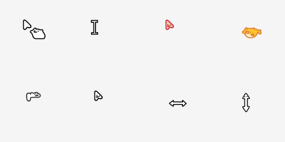

# **A Cat Cursor Theme**

[中文](./README.md) | English

## Preview



| Style | Description | Preview |
| --- | --- | --- |
| Default arrow | Everyday pointer with animated cat |  |
| Text select | I-beam for typing |  |
| Link / hand | Hovering links and clickable areas |  |
| Grab | Dragging, closed hand |  |
| Wait | Loading animation |  |
| Progress | Busy but clickable |  |
| Horizontal resize | Left-right resizing |  |
| Vertical resize | Up-down resizing |  |

> All cursors are animated. Previews show a single representative frame.

## Designer

| | |
| --- | --- |
| **Designer** | [**HappyCadogt**](https://space.bilibili.com/406949928) |
| **Bilibili** | [@406949928](https://space.bilibili.com/406949928) |
| **Showcase video** | [Loading cat cursor demo](https://www.bilibili.com/video/BV1S2itBHEJH/) |

**HappyCadogt** is the original designer of the Cat Cursor theme, responsible for all artwork and animations. The Linux and macOS ports in this repository are based on their work. **All design rights belong to the original author.** If you enjoy this theme, please follow and support them on Bilibili.

## About

- **Original design**: [Bilibili @HappyCadogt (UID: 406949928)](https://space.bilibili.com/406949928)
- **Linux port**: [GitHub @Tseshongfeeshur (Ryan)](https://github.com/Tseshongfeeshur)
- **macOS port**: [GitHub @Amory0709](https://github.com/Amory0709) — `mac/` directory in this repo

As of the project release date (2026-02-10), the original author only provided a Windows version. Ryan ported it to an [XDG cursor theme package](https://specifications.freedesktop.org/icon-theme/latest/) for GNU/Linux. This repository also includes a macOS port based on [Mousecape](https://github.com/alexzielenski/Mousecape).

**Many thanks to HappyCadogt — without their original design, none of these ports would exist.**

## Project Content

- **Independently designed and created** by [**HappyCadogt**](https://space.bilibili.com/406949928)
- Hand-drawn cat style; **fully** animated cursors
- Supports **24 / 32 / 48 / 64 / 96 / 128 / 192 / 256** pixel resolutions

## Supported Platforms

| Platform | Status | Notes |
| --- | --- | --- |
| Windows | Original | Download from [Bilibili @HappyCadogt](https://space.bilibili.com/406949928) |
| GNU/Linux | Ported | XDG theme; tested on KDE Plasma and GNOME |
| macOS | Ported | Requires [Mousecape](https://github.com/alexzielenski/Mousecape/releases); see [`mac/README.md`](./mac/README.md) |

---

## Linux Installation

### Arch Linux (recommended)

#### Install with an AUR helper

```zsh
paru -S cat-cursors-git
```

Or with another AUR helper:

```zsh
yay -S cat-cursors-git
```

#### Install the AUR package manually

```zsh
sudo pacman -S --needed base-devel
git clone https://aur.archlinux.org/cat-cursors-git.git
cd cat-cursors-git
makepkg -si
```

### Other distributions (manual installation)

1. Install `git`

   Debian / Ubuntu:
   ```zsh
   sudo apt update
   sudo apt install git
   ```

   Fedora:
   ```zsh
   sudo dnf install git
   ```

   Arch Linux:
   ```zsh
   sudo pacman -S git
   ```

2. Clone and install for the current user (recommended):

   ```zsh
   git clone https://github.com/Amory0709/cat-cursors.git hei_cursors
   mkdir -p ~/.local/share/icons/
   mv ./hei_cursors ~/.local/share/icons/
   ```

   Or install system-wide (not recommended):

   ```zsh
   git clone https://github.com/Amory0709/cat-cursors.git hei_cursors
   sudo mkdir -p /usr/share/icons/
   sudo mv ./hei_cursors /usr/share/icons/
   ```

---

## Applying the Theme on Linux

### KDE Plasma

1. Open **System Settings → Appearance & Style → Colors & Themes → Cursors**, or run:
   ```zsh
   systemsettings kcm_cursortheme
   ```

2. Select the "**A Cat**" theme and click "**Apply**"
3. Choose a comfortable cursor size

### GNOME

1. Install `gnome-tweaks`
2. Open **Tweaks → Appearance → Cursor**
3. Select "**Cat_cursor**" from the dropdown
4. Set cursor size, for example:
   ```zsh
   gsettings set org.gnome.desktop.interface cursor-size 48
   ```

### Other desktop environments

Refer to your environment's documentation for applying XDG cursor themes.

---

## macOS Installation

macOS does **not** support native system-wide cursor themes like Windows or Linux. You need [Mousecape](https://github.com/alexzielenski/Mousecape/releases).

### Quick start

1. Install Mousecape
2. Run the installer script:

   ```bash
   cd mac
   chmod +x install.sh
   ./install.sh
   ```

3. On first use, choose **Install Helper Tool** in the Mousecape menu so cursors persist after login

See **[mac/README.md](./mac/README.md)** for DMG packaging, manual import, and build instructions.

---

## Acknowledgements

- **Designer [HappyCadogt](https://space.bilibili.com/406949928)** ([Bilibili @406949928](https://space.bilibili.com/406949928)): all cursor artwork and animations
- **Ryan (Tseshongfeeshur)**: Linux XDG port
- **Amory0709**: macOS port and repository maintenance
- **`xorg-xcursorgen`**: multi-resolution cursor generation

## Links

- Designer on Bilibili: https://space.bilibili.com/406949928
- Showcase video: https://www.bilibili.com/video/BV1S2itBHEJH/
- Blog post (Linux): https://blog.ryanyuan.top/2026/02/10/cat-cursors/
- Upstream Linux port: https://github.com/Tseshongfeeshur/cat-cursors
