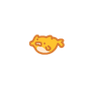
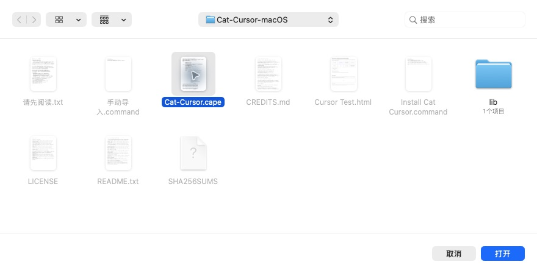
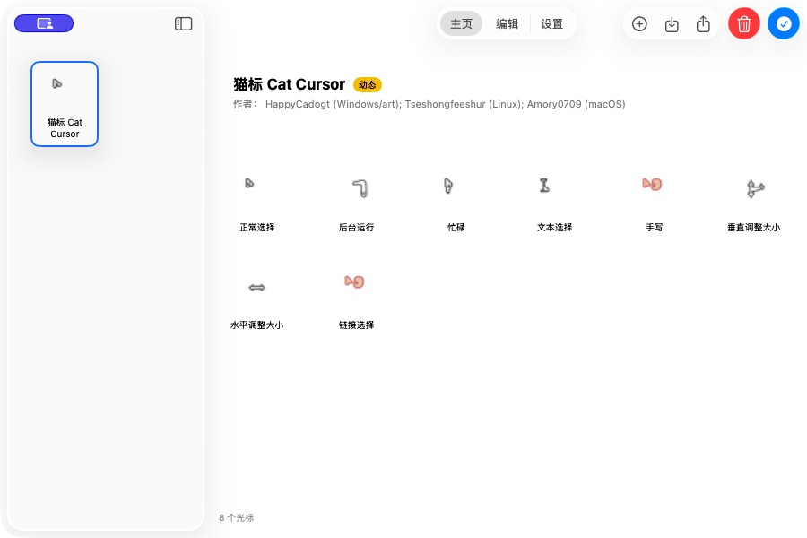
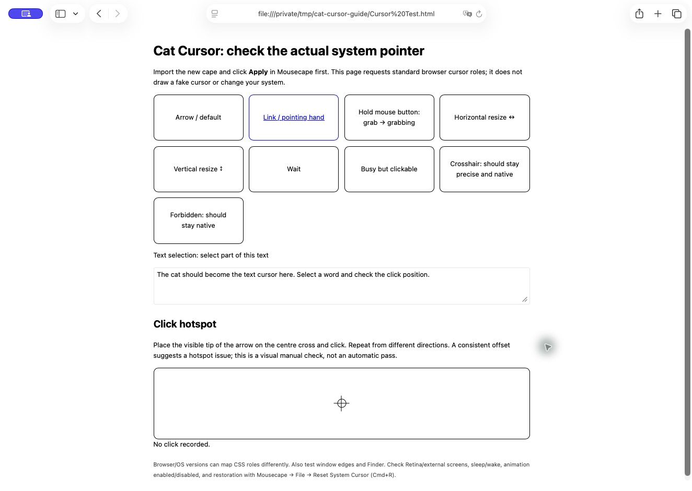

  
  
  

<h1 align="center">Cat Cursor 🐾</h1>

A little cat to keep your Mac pointer company.

<a href="README.md">中文</a> · English

A **macOS port** of HappyCadogt's 猫标. The Windows original and cat artwork are by [HappyCadogt](https://www.bilibili.com/video/BV1S2itBHEJH/).

> 🪟 **Windows cats live here: [original download (Lanzou)](https://happycadogt.lanzoul.com/b01881lrdg)** — password: **`1145`**. See the [creator's video and comments](https://www.bilibili.com/video/BV1S2itBHEJH/) for installation and updates. The steps below are for Mac 🐾

## 🐱 Two ways to bring a cat to Mac

| | This theme + [Mousecape-swiftUI](https://github.com/sdmj76/Mousecape-swiftUI) | [neco0w0/CatCursor](https://github.com/neco0w0/CatCursor) |
| --- | --- | --- |
| Setup | Import the `.cape` theme and click Apply; illustrated below | [Download the standalone app](https://github.com/neco0w0/CatCursor/releases/latest), launch it and use its menu bar controls; no Mousecape needed |
| How it works | Replaces system cursors through Mousecape | Hides the system cursor and draws a cat that follows the pointer |
| Good for | Switching themes and editing cursor images and click hotspots | A dedicated cat app with size controls and a click-paw animation toggle |
| Things to know | Up to 24 animation frames; some apps override system cursors | Its author notes slight tracking lag, possible system-cursor flashes when switching apps, and calibration when shape detection is inaccurate |

The alternative's description comes from its README; **we have not tested it on this Mac**. Before switching approaches, restore the default system cursor or quit the previous cursor app.

🧰 What else can Mousecape do?

Mousecape is a general **Mac cursor manager**. A `.cape` file contains a whole cursor theme; cats are just one option.

- **Switch and back up themes:** import, export, preview and switch other `.cape` themes, or restore system defaults.
- **Make your own theme:** edit static images, animations and the hotspot that determines where a click lands.
- **Convert Windows cursors:** import `.cur` / `.ani` files as Mac themes. This repository has already done the conversion; just import `Cat-Cursor.cape`.

See the [official Mousecape features](https://github.com/sdmj76/Mousecape-swiftUI#features) for more.

## 🐈 Bring home two downloads for Mac

| Download | Choose this file |
| --- | --- |
| [**Mousecape-swiftUI manager**](https://github.com/sdmj76/Mousecape-swiftUI/releases/latest) | Recommended official **1.2.0**: `Mousecape_swiftUI_v1.2.0.zip`. Unzip and move the app to Applications. |
| [**Cat Cursor v1.3.0 theme**](https://github.com/Amory0709/cat-cursors/releases/tag/v1.3.0) | Under Assets, download and unzip **`Cat-Cursor-macOS-v1.3.0.zip`**. |

Manager 1.2.0 supports **macOS 14+, Apple Silicon and Intel**. Use **sdmj76/Mousecape-swiftUI**; legacy Mousecape is a different project. Keep an existing working SwiftUI installation.

`Source code (zip)` is **not an install package**. Old Cat Cursor v1.0.0–v1.2.0 packages have been withdrawn; use the repaired version above.

## 🐾 Three steps to a cat pointer

Before upgrading, back up the old theme with **File → Export Cape**. Only overwrite a backed-up cat theme. No `.command` script, `sudo`, or disabled security settings needed.

### ① Import this `.cape` file

Open **Mousecape.app** and choose **File → Import Cape…** from the macOS menu bar, or click the **downward arrow into a tray** in the window's upper-right toolbar. In the extracted folder, select **`Cat-Cursor.cape`** and click **Open** (打开 in the screenshot).

### ② Select the cat, then click the blue checkmark

Select **猫标 Cat Cursor** on the left. Click the **blue circular checkmark ✓** at the far upper right: this is **Apply**. Importing alone is not enough; check for **Applied** afterward.

### ③ Take your cat for a test

Open the package's **`Cursor Test.html`** in Safari. Hover the blue **Link**, select words under **Text selection**, hold the mouse button in the **grab** area, and try horizontal and vertical resizing. Click the centre cross under **Click hotspot** to check alignment, then try Finder too.

Screenshots show Mousecape-swiftUI 1.2.0 in Chinese and Safari, and illustrate the controls only. Check animation, transparency and click alignment with the actual pointer on your screen. Precision crosshairs and forbidden-operation cursors stay native.

> 🐱 On **2026-10-15**, the repaired theme was imported and applied on **macOS 26.6.2 / Apple Silicon / Mousecape-swiftUI 1.2.0**, and the user confirmed success. This is one-machine evidence, not universal compatibility. [Validation record](docs/VALIDATION.md)

## 🧶 A few cat-care tips

- **No change?** Make sure you clicked Apply. If it only works in the Dock, see the manager's [troubleshooting guide](https://github.com/sdmj76/Mousecape-swiftUI#troubleshooting).
- **Want your old pointer back?** Choose **File → Reset System Cursor** (⌘R), or import your exported theme and Apply it.
- **Some cursors stay native?** Precision crosshairs and forbidden-operation cursors intentionally keep their meaning. Animations have at most 24 frames, so longer ones lose poses. Login reapplication is optional.

## ♡ The people behind the cats

**Windows original/art: [HappyCadogt](https://space.bilibili.com/406949928)** · **Linux source port: [Tseshongfeeshur / Ryan](https://github.com/Tseshongfeeshur/cat-cursors)** · **macOS port: [Amory0709](https://github.com/Amory0709)**

[Full credits](CREDITS.md) · [Build and verify](mac/README.md) · [Report an issue](https://github.com/Amory0709/cat-cursors/issues)
